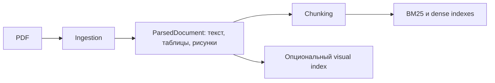
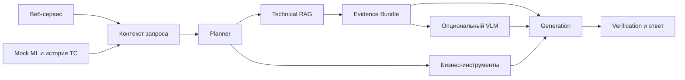

# Цифровой механик — общий контекст проекта

Рабочая спецификация команды хакатона «ИИкузница». Формальные требования задаёт ТЗ v6, условия эксплуатации и приоритеты уточняет брифинг. Назначения, статусы и блокеры ведутся в GitHub Issues, измеренные прогоны — в комментариях к журналу. [Индекс проекта](https://github.com/ofdun/ai-mechanic/issues/1) · [Журнал экспериментов](https://github.com/ofdun/ai-mechanic/issues/9) · [Подключение агентов](project-context.md)

## 1. Проект

За 48 часов команда готовит AI-агента «Цифровой механик» для ООО «НейроДВС». Он объясняет результат внешней акустической диагностики, находит применимые места в руководствах, предлагает проверяемые действия и после подтверждения механика оформляет заявку на дефектовку. Качество Technical RAG, технического reasoning и верификации сравнивается со стоимостью полного цикла. Заказчик отвечает за запись и обработку звука двигателя, акустическую диагностику и поставляет Mock ML, Mock ТОиР и их OpenAPI-спецификации. [Командный репозиторий](https://github.com/ofdun/ai-mechanic)

## 2. Материалы заказчика

Каноническое расположение для запуска — `DATA_DIR=./data`. В рабочем окружении комплект может лежать рядом с checkout. Укажите фактический `DATA_DIR`. Для сопоставления путей учитывайте NFC, для чтения используйте фактическое имя. Внешний архив `007_хакатон_ИИ.zip` содержит копии распакованных файлов, поэтому при построении корпуса учитывайте их один раз.

- `Описание_кейса_ИИкузница_НейроДВС_v2_2026-11-15.docx`
- `ТЗ_хакатон_ИИкузница_НейроДВС_v6_2026-11-16.docx`
- `Цифровой механик_Описание БПроцессов для команд (v6).docx`
- `neurodvs_hackathon_mock_2026-11-16.zip` с `data/vehicles.json`, `data/fault_types.json`, `mock_ml/app.py`, `mock_toir/app.py`, `openapi_ml.json`, `openapi_toir.json` и тестами. История вложена в `vehicles[].sessions[]`. Модель двигателя хранится в `vehicles[].engine_model`.

| Двигатель | Руководство | Файл | Страниц PDF |
|---|---|---|---:|
| ЯМЗ-236М2 | 236-3902150-Б РЭ, 2010 | `ЯМЗ_236_руководство по эксплуатации.pdf` | 172 |
| ЯМЗ-236М2 | 236.01.01 РК, 2014 | `ЯМЗ_236_руководство по РЕМОНТУ.pdf` | 287 |
| ЯМЗ-536 | 536.3902150 РЭ, 2016 | `yamz-536_re_2016.pdf` | 285 |
| ЯМЗ-536 | 536.01.02 РК, 2013 | `yamz-536_rk_2013.pdf` | 603 |
| ЗМЗ-5234.10 | Руководство по ремонту, 2025 | `zmz-5234_rk_2025.pdf` | 158 |
| ЗМЗ-40904.10 и ЗМЗ-40905.10 | Эксплуатация, ТО и ремонт, 2025 | `zmz-40904-40905_rk_2025.pdf` | 238 |
| | Всего | | 1743 |

Обследование Poppler и выборочная проверка PyMuPDF подтвердили 1735 страниц с извлекаемым текстом. Среди восьми без текста две обложки и шесть растровых страниц 236.01.01 РК с таблицами или рисунками (144, 272, 273, 277, 278, 280). 54 другие страницы дают мало текста. Таблицы на несколько модификаций требуют проверки строки, колонки и единиц. У ЯМЗ-536 РЭ физическая страница 272 со схемой затяжки имеет печатный номер 271. У ЯМЗ-536 РК печатная нумерация может начинаться заново внутри модуля. Tesseract для русского OCR требует языковой пакет `rus`.

В синтетической истории 50 ТС, по 3–5 сессий, всего 195. Статусы по всем сессиям — 111 normal, 69 anomaly, 15 check_failed. Из 69 аномалий 52 имеют `good`, 17 — `warning`. Последние по ТС — 25 normal, 23 anomaly, 2 check_failed. Три случая с `good` и высокой уверенностью содержат гипотезу, несовместимую с топливом из карточки. Это контрольные кейсы для применимости рекомендаций.

## 3. Требования и приёмка

| ID | Обязательный результат |
|---|---|
| F1 | Адаптивный веб-интерфейс с чатом |
| F2 | Выбор ТС и сессии, вызов Mock ML и показ вердикта |
| F3 | Отдельная обработка `normal`, `anomaly`, `check_failed` |
| F4 | Technical RAG по точной модели с документом и физической страницей PDF |
| F5 | Агентный выбор инструментов диагностики, поиска и заявки |
| F6 | URL внешних сервисов из окружения и несекретный `.env.example` |
| F7 | Создание заявки в Mock ТОиР после явного подтверждения механиком |

Бонусы по ТЗ — B1 память по ТС (3 балла), B2 график `anomaly_score` за 3–5 проверок (3), B3 сводка и очередь главного механика (4). Мультиязычность желательна. Разбор схем, например порядка затяжки, усиливает демо. История поддерживает описание динамики. Отсрочку поломки, каталог запчастей и собственную модель звука двигателя команда не планирует. При наличии в руководстве допустим документированный общий осмотр вместо узкой процедуры. Для реальных данных согласовать облачную обработку и требования 152-ФЗ с владельцем платформы до подключения.

Оценка — работоспособность 30, RAG 20, архитектура и код 20, UX 15, дополнительные функции и видео 15. Часть вопросов жюри неизвестна. Формальные контрольные сценарии C1–C3 и дополнительный C4 описаны в разделе 16.

## 4. Роли и границы ответственности

| Участник | Зона | Модули |
|---|---|---|
| Вадим | ML Lead, Agent Core, Planner, общий skeleton, интеграция | `contracts`, `providers`, `planner`, `tools`, `agents`, `pipeline` |
| Валерий | Retrieval и RAG, chunking, embeddings, индексы и ранжирование | `retrieval` |
| Роман, предварительно | Document Intelligence и выпуск `ParsedDocument` | `ingestion` |
| Алексей | Generation и Verification, Oracle Context | `generation` |
| Елисей | Backend, Frontend, мобильный UX, пользовательский веб-сервис и деплой | Веб-сервис |
| TBD | Мультимодальный RAG и VLM | `vision` |

Вадим ведёт каркас ядра, общие интерфейсы, конфигурацию и клиенты сервисов заказчика. Каждый компонент развивается в общем репозитории. Елисей владеет конечным веб-приложением. GitHub Assignees назначаются по известным команде логинам. Роль Романа предварительная.

## 5. Входы, выходы и внешние контракты

Веб-сервис передаёт текстовый запрос или явную команду, пару `vehicle_id/session_id`, идентификатор диалога, подтверждение и, опционально, изображение. Агент получает карточку машины, модель двигателя, диагностику и историю из доверенных адаптеров. Контекст привязывается к пользователю, ТС и сессии. При смене ТС или сессии старые диагнозы, черновики и источники не переиспользуются.

### Mock ML

`POST /diagnose` принимает `{"vehicle_id":"…","session_id":"…"}` и возвращает:

```json
{
  "vehicle_id": "...",
  "session_id": "...",
  "status": "anomaly",
  "anomaly_type": "F08",
  "anomaly_title": "Дизельная топливоподача",
  "anomaly_score": 0.76,
  "confidence": 0.73,
  "signal_quality": "good",
  "description": "...",
  "model_version": "mock-v1"
}
```

- `normal` означает отсутствие значимых отклонений в рамках замера. Код и заголовок неисправности равны `null`.
- `anomaly` требует интерпретации. `anomaly_score` описывает степень аномальности, `confidence` уверенность модели, `signal_quality` качество записи. Приоритет дефектовки зависит от документированных условий и наблюдений.
- `check_failed` требует повторного замера без заключения и заявки. Код, заголовок, оценка и уверенность равны `null`. Низкая уверенность и `bad` также блокируют заявку. Конфигурируемый порог `confidence < 0.70` и повтор при `warning` — временное предложение, ожидающее согласования.
- Модель берётся из карточки ТС. Агент сохраняет исходное предсказание и проверяет пригодность результата и применимость действий. При конфликте кода с моделью или типом топлива сообщает об этом и блокирует неподтверждённую заявку.

Коды F01–F14 соответственно обозначают клапанный механизм, давление масла, перегрев или ОЖ в масле, ремённый привод, генератор, сцепление, КПП, дизельную топливоподачу, наддув, пневмокомпрессор или ГУР, EGR, зажигание, бензиновую топливоподачу, цепь ГРМ и гидронатяжитель. Для retrieval использовать термины руководств и профили симптомов.

### Ответ и заявка

Ответ включает понятный вердикт, наблюдения, возможные причины, риски, проверки, нормативы, ремонтные действия, подтверждённые запчасти, ссылки, ограничения, `requires_remeasurement` и `can_create_ticket`. Технический claim привязывается к доказательству. При нехватке данных агент ограничивает ответ.

`POST /tickets` принимает следующий JSON и возвращает `{"ticket_id":"…","status":"created"}`:

```json
{
  "vehicle_id": "...",
  "session_id": "...",
  "anomaly_type": "F08",
  "conclusion": "...",
  "urgency": "medium",
  "operations": ["..."],
  "spare_parts": [],
  "references": [{"manual": "...", "pdf_page": 1}]
}
```

Все поля обязательны. `operations` и `references` непустые, `spare_parts` может быть пустым. `urgency` принимает `low|medium|high`. Сервер проверяет снимок диагностики, пару ТС–сессия, версию черновика, доказательства и явное действие механика. Агент готовит черновик, а инструмент записи вызывается проверяемым путём подтверждения.

Тесты поставленных моков прошли 20/20. HTTP-проверки подтвердили `200`, `201`, `404`, `422` и `418` для невалидной заявки со старыми именами. ТОиР хранит записи в памяти, повторяет нумерацию после рестарта и выдаёт разные ID при двух одинаковых POST. Предложено хранить квитанцию и ключ сессии и аномалии на стороне агента. При неизвестном результате записи сохраняется `TICKET_OUTCOME_UNKNOWN`, автоматический POST не повторяется.

### Веб-приложение механика

React получает список машин и замеров через `GET /api/vehicles`. Диагностика, вопрос и подготовка черновика проходят через `POST /agent/run`. Механик проверяет состав работ и отдельно подтверждает заявку через `POST /agent/tickets/confirm`. Сервер привязывает диалог к браузерной сессии, машине и замеру. При неизвестном результате отправки интерфейс блокирует повтор и просит сверить статус в ТОиР. [Веб-сервис](../app/backend/main.go) · [Маршруты агента](../ml/api.py)

Из отчёта, чата и черновика механик открывает физическую страницу в том же окне. Маршрут `GET /api/documents/{document_id}/pages/{page_number}` возвращает текст страницы, а с `?view=image` — её изображение. Сервер проверяет документ по индексу и контрольной сумме. [Просмотр страниц](../app/frontend/src/ManualReader.jsx)

Сквозной прогон на учебном парке с отдельным руководством проверяет три исхода диагностики, ссылки, возврат к отчёту и выдачу номера заявки. Для приёмки на материалах заказчика остаются прогон на физическом телефоне и согласование корпоративной идентификации и доступа к руководствам. [Мобильная приёмка](../tests/e2e/README.md) · [Контракт интеграции](https://github.com/ofdun/ai-mechanic/issues/3) · [Веб-задача](https://github.com/ofdun/ai-mechanic/issues/6)

## 6. Общая архитектура



Роман предварительно отвечает за `ParsedDocument`, Валерий за chunking, embeddings и индексы. Для каждой страницы и фрагмента нужны `document_id`, применимые двигатели, раздел, физический номер, текст и тип содержимого. Хранить SHA-256 и версию корпуса. Для норм сохранять связь значения, строки, колонки, условий, единицы и примечаний. Для процедур подгружать родительский раздел или связанные страницы.



У новой диагностики первый шаг — Mock ML, затем fault-aware retrieval. Уточнение использует текущий контекст. Planner совмещает выбор инструментов, rewriting и decomposition. Внутренний RAG выполняет программный пайплайн. Ветка нормы и невалидного замера может завершиться без обращения к RAG и генератору.

## 7. Общий retrieval engine

`SearchPlan → фильтр модели → BM25 и exact dense → RRF → cross-encoder → родитель и страницы → EvidenceBundle`.

Быстрый контрольный старт — Poppler, SQLite FTS5 и BM25 на CPU. Сравнивать page-level и структурный chunking, dense отдельно и hybrid на той же разметке. Для full hybrid стартовые значения — dense top-30, BM25 top-30, RRF constant 60, rerank 30–50 кандидатов, 5–10 фрагментов, 3–5 подзапросов при decomposition, 4K–16K токенов. Параметры экспериментальные. Exact cosine через NumPy или FAISS IndexFlatIP подходит для проверки на этом объёме, после нормализации векторов и замера latency. Метаданные применимости фильтруют результаты до top-k, верификация проверяет условия и физическую страницу повторно.

## 8. Архитектура A и контроль A0

A — P0. При готовом диагностическом контексте три LLM-вызова. A0 — контроль из Planner и Generator с сохранением детерминированных проверок.

| Вызов A | Стартовый кандидат | Результат |
|---|---|---|
| 1. Planner | GLM 5.3 Flash | Tool calling, rewrite, decomposition, поисковое намерение |
| 2. Generator | DeepSeek V4.1 Flash | Технический черновик с возможными причинами, рисками, проверками, нормами и источниками |
| 3. Verifier и Finalizer | GLM 5.3 Flash | Проверенные утверждения и короткий ответ механику |

После финализации код проверяет схему, apply-to-engine, связанные источники, страницу, численные значения и условия, а также бизнес-ограничения. Финальный текст не может расширять технические факты сверх принятых claims.

## 9. Архитектура B

B — P1, сравнение с A на том же retriever и corpus. Пять обязательных вызовов и один условный.

| Вызов B | Стартовый кандидат | Результат |
|---|---|---|
| 1. Tool Planner | GLM 5.3 Flash | Инструменты и контекст диагностики |
| 2. Query Strategist | GLM 5.3 Flash | Поисковая стратегия |
| 3. Technical Reasoner | GLM 5.3 | Атомарные claims с `evidence_ids` |
| 4. Evidence Critic | DeepSeek V4.1 Flash | Проверка claims, пробелы, поисковые запросы |
| Условный Repair | DeepSeek V4.1 Flash | Исправленные claims по дополнительным доказательствам |
| 5. Finalizer | GLM 5.3 Flash | Ответ только из проверенных claims |

Corrective Retrieval ограничен одной итерацией. Repair оценивает результат повторно. Для отдельной независимой проверки возможен седьмой LLM-вызов. Завершающая валидация схемы, цитат и бизнес-правил обязательна и для B.

## 10. Модели и инструменты для сравнения

LLM gateway — OpenRouter, base URL `https://openrouter.ai/api/v1`. Публичный каталог вернул все пять ID из списка. Перед прогоном нужно проверить конкретный endpoint, доступные параметры provider route, structured output, tool calling, vision и фактические условия тарифа. Сначала сравнить Flash-кандидатов. Более дорогой маршрут включать при измеримом приросте. Opus не входит в основной пайплайн. [Каталог моделей OpenRouter](https://openrouter.ai/api/v1/models) · [Спецификация каталога](https://openrouter.ai/docs/api/api-reference/models/list-all-models-and-their-properties)

| ID | Назначение |
|---|---|
| `z-ai/glm-5.3-flash` | Planner, rewrite, verifier, finalizer и кандидат vision |
| `deepseek/deepseek-v4.1-flash` | Planner, generator, critic и кандидат vision |
| `z-ai/glm-5.3` | Сложный technical reasoning |
| `qwen/qwen3.6-flash` | Мультимодальный кандидат |
| `google/gemini-3.8-flash` | Контроль vision |

- Embeddings по порядку — `BAAI/bge-m3`, `Qwen/Qwen3-Embedding-0.6B`, `intfloat/multilingual-e5-large-instruct`, `Qwen/Qwen3-Embedding-4B`, `Qwen/Qwen3-Embedding-8B` при наличии времени, BGE-M3 sparse и multivector.
- Reranking — контроль без reranker, `BAAI/bge-reranker-v2-m3`, `Qwen/Qwen3-Reranker-0.6B`, `Qwen/Qwen3-Reranker-4B`.
- Parsing — Poppler для контроля, PyMuPDF, PyMuPDF4LLM, Docling, при необходимости MinerU. Русскоязычный OCR применять к проблемным страницам.
- Vision — GLM 5.3 Flash, DeepSeek V4.1 Flash, Qwen3.6 Flash, Gemini 3.8 Flash. Начать с текстового retrieval и VLM по найденной странице или crop. ColPali, ColQwen2, ColPali Engine и Byaldi сравнивать, если текстовый поиск пропускает нужные рисунки.

## 11. Гипотезы и владельцы экспериментов

Все гипотезы ниже запланированы. Фактические результаты, включая отрицательные, добавляются комментариями в журнал. [Журнал экспериментов](https://github.com/ofdun/ai-mechanic/issues/9)

### Ingestion — Роман предварительно

| ID | Гипотеза |
|---|---|
| ING-01 | Текстового слоя достаточно для baseline |
| ING-02 | Docling лучше сохраняет структуру технических процедур |
| ING-03 | Связанные строки и колонки таблиц повышают точность численных ответов |
| ING-04 | Рисунки и подписи повышают полноту мультимодального поиска |

### Retrieval — Валерий

| ID | Гипотеза |
|---|---|
| RET-01 | Page-level retrieval достаточен для baseline |
| RET-02 | Structural chunking улучшает Hit@K |
| RET-03 | Chunk sizes 256/512/1024 tokens различаются по качеству |
| RET-04 | Qwen Embedding превосходит BGE-M3 на технических руководствах |
| RET-05 | Более крупный embedder даёт измеримый прирост |
| RET-06 | BM25 дополняет dense retrieval |
| RET-07 | Hybrid + RRF повышает recall |
| RET-08 | Cross-encoder улучшает top-K |
| RET-09 | Parent-child retrieval повышает полноту контекста |
| RET-10 | Оптимизация top-K и token budget улучшает качество относительно стоимости |

### Agent Core — Вадим

| ID | Гипотеза |
|---|---|
| AG-01 | Недорогие LLM надёжно выполняют tool calling |
| AG-04 | Query rewriting повышает Hit@K |
| AG-05 | Original + rewritten query лучше одного rewrite |
| AG-06 | Multi-query decomposition увеличивает полноту поиска |
| AG-07 | Fault-aware context улучшает retrieval |
| AG-08 | Профили F01–F14 повышают релевантность запросов |
| AG-09 | Единый Planner эффективнее раздельных LLM-вызовов |
| AG-10 | A0 достаточна как контрольный baseline |
| AG-11 | Третий LLM-вызов повышает надёжность A |
| AG-12 | B повышает качество относительно A |
| AG-13 | Corrective Retrieval восполняет недостающие доказательства |
| AG-14 | Кеш и ограничение вызовов снижают стоимость и задержку |

### Generation — Алексей

| ID | Гипотеза |
|---|---|
| GEN-01 | Недорогой LLM достаточно при качественном Oracle Context |
| GEN-02 | GLM 5.3 улучшает technical reasoning |
| GEN-03 | Структурирование атомарных claims снижает число ошибок |
| GEN-04 | Evidence Critic сокращает долю неподтверждённых утверждений |
| GEN-05 | Critic другого семейства снижает корреляцию ошибок |
| GEN-06 | Finalizer улучшает понятность и сохраняет факты |
| GEN-07 | Программная проверка нормативов и ссылок повышает надёжность |

### Vision — владелец открыт

| ID | Гипотеза |
|---|---|
| VIS-01 | VLM корректно интерпретирует технические рисунки |
| VIS-02 | Crop рисунка эффективнее полной страницы |
| VIS-03 | Рисунок с текстом повышает качество относительно изображения отдельно |
| VIS-04 | Текстового RAG с VLM достаточно для большинства визуальных вопросов |
| VIS-05 | Offline VLM captions улучшают поиск |
| VIS-06 | ColQwen или ColPali повышает полноту визуального поиска |

## 12. Оценка

Собран набор из 241 кейса по ТЗ v6, описанию кейса, бизнес-процессам и шести руководствам. В наборе 206 RAG-кейсов с эталонами, 25 основных сценариев агента, 8 кейсов дополнительных функций и 2 примера для проверки переформулирования. Для оценки попадания в источник у 202 RAG-кейсов указаны физические страницы или диапазоны ремонтных модулей. Размечены также частичные ответы, случаи недостаточности данных и расхождения между источниками. [Датасет](https://github.com/ofdun/ai-mechanic/blob/8e7a6e6232a4fb8c522623b2d949af210cc40998/evaluation/datasets/customer_questions.jsonl) · [Формат и правила разметки](https://github.com/ofdun/ai-mechanic/blob/8e7a6e6232a4fb8c522623b2d949af210cc40998/evaluation/datasets/README.md)

Разбиение содержит 170 примеров для разработки и 71 отложенный, из них 143 и 63 RAG-кейса соответственно. Связанные варианты запросов остаются в одной части. Для настройки использовать dev. При прогоне передавать агенту текст и рабочий контекст, сохраняя эталонные ответы, страницы и ожидаемые инструменты для оценщика.

Для демо по ЯМЗ-236М2 заказчик согласовал регулировку тепловых зазоров на холодном двигателе. В РЭ на физической стр. 31 и в РК на физических стр. 269 и 276 условия по времени после остановки расходятся. Минимальная выдержка по РК сама по себе не подтверждает остывание. Агент показывает обе формулировки с документами и страницами, отмечает расхождение и предлагает уточнить применимость у специалиста или производителя для конкретной модификации. Это проверяют `Q008` и `Q241`.

| Направление | Метрики |
|---|---|
| Retrieval | Hit@1/3/5/10, Recall@K, MRR, nDCG |
| Generation | Correctness, Numeric Accuracy, Citation Accuracy |
| Verification | Unsupported Claim Rate, Abstention Accuracy |
| Agent | Tool Selection Accuracy, Schema Validity, E2E Success |
| Vision | Sequence Accuracy, Diagram Accuracy, Numeric Accuracy |
| Efficiency | Cost, p50/p95 latency, RAM и VRAM |

Сравнительный прогон на этом наборе предстоит. Сначала измерить поиск по исходному запросу, переформулировке и их комбинации на одном индексе. Затем проверить генерацию с одинаковыми эталонными фрагментами и сравнить A0, A и B на одном поисковом движке. Технические нормативы и критические случаи сверять с оригиналом руководства вручную. Для воспроизведения сохранять версию кода, корпуса и датасета, выборку, модель и маршрут провайдера, настройки, метрики, примеры ошибок, задержку и стоимость. [Карточка оценки](https://github.com/ofdun/ai-mechanic/issues/7) · [Журнал экспериментов](https://github.com/ofdun/ai-mechanic/issues/9)

## 13. Экономика и инфраструктура

Рабочая гипотеза — LLM и VLM по API, онлайн retrieval на CPU. Офлайн для embedding benchmark и индексации достаточно начать с одной GPU. Тяжёлый visual retrieval требует отдельного обоснования. Онлайн стартовая оценка — 4–8 vCPU, 8–16 GB RAM, без GPU. Exact dense и BM25 локальны, embedding и rerank на CPU или через API по замерам. Облачное размещение и один механик — исходные условия расчёта.

В таблице USD за 1M токенов. Расчётный тариф из брифа сохранён для воспроизведения оценки. Публичный каталог OpenRouter проверен 26.11.2026. Показанные в нём цены не гарантируют тот же тариф на конкретном маршруте. [Каталог OpenRouter](https://openrouter.ai/api/v1/models)

| Модель | Тариф сценария input / output | Публичный каталог input / output |
|---|---:|---:|
| GLM 5.3 Flash | 0.05 / 0.50 | 0.15 / 0.50 |
| DeepSeek V4.1 Flash | 0.12 / 0.48 | 0.14 / 0.42 |
| GLM 5.3 | 0.0699 / 1.40 | 0.0699 / 1.40 |
| Qwen3.6 Flash | 0.1875 / 1.125 | 0.1875 / 1.125 |
| Gemini 3.8 Flash | 0.75 / 3.75 | 0.825 / 4.125 |

| Вариант | Вызовы | Гипотеза input / output | Цена по исходному сценарию |
|---|---:|---:|---:|
| A0 | 2 | 9500 / 1500 | $0.001761 |
| A | 3 | 16500 / 2000 | $0.002361 |
| B | 5 | 26500 / 3950 | $0.005805 |
| B + Repair | 6 | 31500 / 4750 | $0.006789 |

Цены цикла из брифа относятся к текстовым LLM и остаются предварительными. Для пересчёта по каталогу или фактическому provider route нужны токены по каждому вызову. В суммы выше не входят VLM, embedding, reranking, retries, комиссии, инфраструктура и хранение. Раздельно измерять offline индексацию, уточняющий вопрос, полный цикл с заявкой и эксплуатацию на одного механика. Бюджет экспериментов — ориентир $50, до $100 при необходимости.

Общий LLM client логирует request ID, модель, provider route, входные, выходные и reasoning tokens, стоимость с валютой, latency, retries и число вызовов. Для стадий при наличии учитываются изображения и tool calls. Для локального размещения учесть время ресурсов и амортизацию. Закладывать кеш retrieval и ограничение контекста и вызовов. Сырые медиа, пользовательские запросы и ключи не включать в общие логи.

## 14. Open source и референсы

- Document Intelligence: [PyMuPDF](https://github.com/pymupdf/PyMuPDF), [Docling](https://github.com/docling-project/docling), [MinerU](https://github.com/opendatalab/MinerU).
- Retrieval: [FlagEmbedding](https://github.com/FlagOpen/FlagEmbedding), [Qwen3-Embedding](https://github.com/QwenLM/Qwen3-Embedding), [sentence-transformers](https://github.com/huggingface/sentence-transformers).
- RAG и агенты: [Haystack](https://github.com/deepset-ai/haystack), [LlamaIndex](https://github.com/run-llama/llama_index), [Pydantic AI](https://github.com/pydantic/pydantic-ai), [haiku.rag](https://github.com/ggozad/haiku.rag), [RAGFlow](https://github.com/infiniflow/ragflow).
- Vision и оценка: [ColPali](https://github.com/illuin-tech/colpali), [Byaldi](https://github.com/AnswerDotAI/Byaldi), [Ragas](https://github.com/explodinggradients/ragas).
- Архитектурные референсы: [Self-RAG](https://github.com/AkariAsai/self-rag), [Corrective RAG](https://github.com/HuskyInSalt/CRAG), [DSPy](https://github.com/stanfordnlp/dspy).

Проверять лицензии и совместимость до принятия зависимости. Подключать готовые компоненты по необходимости, полный стек RAG-платформы требует обоснования.

## 15. Структура и общие контракты

Целевую структуру адаптировать к командному коду. Работа по модулям идёт в отдельных ветках. Платформенные ключи, исходный комплект и тяжёлые производные не входят в коммиты.

```text
ai-mechanic/
├── data/
├── ml/
│   ├── contracts/       providers/       ingestion/
│   ├── retrieval/       generation/      vision/
│   ├── planner/         tools/
│   ├── agents/          [compact.py, evidence_grounded.py]
│   └── pipeline.py
├── configs/             [compact.yaml, evidence_grounded.yaml, retrieval.yaml]
├── evaluation/          [datasets/, retrieval/, generation/, agent/, results/]
├── tests/               [fixtures/]
├── artifacts/           [parsed/, indexes/]
├── docs/                [архитектура, контракт, эксперименты, ответственность]
└── .env.example
```

| Контракт Pydantic | Направление |
|---|---|
| `DocumentPage`, `ParsedDocument` | Ingestion → Retrieval |
| `SearchPlan` | Planner → Retrieval |
| `EvidenceBundle` | Retrieval → Generation |
| `TechnicalDraft`, `TechnicalClaim` | Generator → Verifier |
| `VerifiedResponse` | Verifier → Agent |
| `AgentResponse` | ML Core → Web Service |
| `DiagnosticResult` | Mock ML → Agent |
| `TicketDraft` | Agent → Web Service → проверяемая отправка в Mock ТОиР |

Контракты должны обеспечивать заменяемость компонентов и изолированные тесты. Метаданные цитаты содержат стабильный `document_id`, обозначение руководства, `pdf_page` от 1 и при наличии печатный номер и раздел. API возвращает структурированные ошибки и идентификатор запроса.

## 16. План на 48 часов и контрольные сценарии

| Фаза | Результат |
|---|---|
| 0. Bootstrap | Каркас, контракты, адаптеры компонентов, LLM client, конфигурация, Git workflow, smoke и договорённости об API |
| 1. Параллельные baselines | Вадим — Planner, переформулирование текстовых запросов и интеграция с Mock ML и Mock ТОиР. Роман предварительно — parsing. Валерий — BM25 и dense. Алексей — Oracle Context. Елисей — веб-сервис и интеграция |
| 2. Работающий MVP | A0, затем A, реальный retrieval, верификация, сквозные C1–C3 |
| 3. Улучшения | Embeddings, chunking, hybrid, rerank, rewriting, fault-aware, LLM benchmark и ablations |
| 4. Расширение | B, corrective retrieval, VLM и B1–B3 по результатам измерений и оставшемуся времени |
| 5. Финальная оценка | E2E, разбор ошибок, качество–стоимость–latency, выбор конфигурации, стабилизация, README, деплой и демонстрация |

Интеграция начинается вместе с разработкой baselines. Первыми выполнить обязательные F1–F7 и стабилизировать C1–C3. README должен давать воспроизводимый запуск. Короткое видео по ТЗ до 60 секунд и сценарии защиты согласуются с владельцем веб-приложения.

| Сценарий | Проверка |
|---|---|
| C1 | Валидная F08 на ЯМЗ-236М2, применимые PDF, рекомендации, черновик, явное подтверждение и `ticket_id`. Повтор подтверждения не создаёт вторую заявку |
| C2 | Вопрос о перегоне машины. Показать найденные применимые ограничения или признать нехватку данных. Выпуск решает специалист |
| C3 | `check_failed`: повтор записи, без заключения и без заявки. Дополнительно проверить низкую уверенность, `warning` и `bad` |
| C4 | Сводка главного механика, история 3–5 проверок, заявки и причина внимания. Категория карантина требует согласованного основания |

Негативные проверки включают чужую сессию или модификацию, смену ТС в диалоге, конфликт гипотезы с топливом, отсутствующую страницу, необоснованную запись, тайм-аут при подтверждении, недоступность API, невалидный черновик и вопрос вне корпуса.

## 17. Общая память и журнал

В начале задачи применить `$project-context`: прочитать этот документ, актуальную справку и связанную Issue. В конце добавить проверенный результат к задаче. Для эксперимента оставить один комментарий на прогон в журнале и связать его с гипотезой и задачей. Можно писать прямо в GitHub. Агенты используют `start --experiments`, `experiment-log --file` или `finish --run-file`. Новые статусы и назначения фиксируются в Issues. Долговременные изменения архитектуры и контрактов отражаются в коде и в этом документе. [Инструкция для команды](project-context.md) · [Индекс](https://github.com/ofdun/ai-mechanic/issues/1) · [Журнал](https://github.com/ofdun/ai-mechanic/issues/9)
